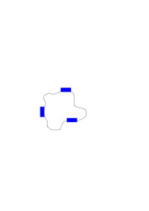

# Problem

## 1. Enunciado

Investigar como a geometria de uma cavidade de pontos quânticos influencia o aparecimento e a manifestação do caos quântico em sistemas com múltiplos terminais.

O sistema é uma cavidade aberta bidimensional limitada por uma forma irregular. A cavidade será acoplada a três terminais elétricos azuis, conforme a disposição ilustrada em `inomeado.svg`, e modelada em rede discreta com o pacote Kwant. Os terminais serão tratados como contatos ideais que possuem largura finita e um modo energético controlado pela energia de Fermi.



**Figura 1: Cavidade de pontos quânticos**

A temperatura será considerada zero e não haverá campo magnético externo. O projeto deverá comparar uma cavidade regular, obtida por uma suavização controlada do contorno irregular, com uma deformação desse contorno representativa da geometria ilustrada.

A pergunta central é:

> Como as deformações da cavidade alteram o transporte quântico, a distribuição espacial das ondas, o espectro de estados e os observáveis característicos de um bilhar caótico em um sistema aberto com três terminais?

## 2. Objetivos

### 2.1 Objetivo geral

Construir uma implementação mínima e reproduzível em Kwant para visualizar e comparar o comportamento regular e o comportamento caótico de uma cavidade quântica irregular em temperatura zero.

### 2.2 Objetivos específicos

1. Representar contornos auxiliares, preservar a posição dos três terminais e exportar as formas utilizadas em SVG ou em formato equivalente.
2. Converter cada contorno em uma lattice tight-binding regular de tamanho escolhido para o cálculo.
3. Calcular a condutância entre pares de terminais como função da energia de Fermi.
4. Calcular densidade local de probabilidade, fluxo de corrente e distribuição espacial da amplitude das funções de onda.
5. Visualizar como o transporte e as distribuições espaciais se modificam ao deformar o contorno.
6. Associar os padrões observados a indicadores clássicos e quânticos de caos, como ergodicidade espacial, sensibilidade geométrica, distribuição de atrasos, estatística de níveis e separação dos níveis.
7. Comparar qualitativamente os resultados da cavidade suave com os da cavidade deformada.

## 3. Modelo físico

Adote o Hamiltoniano tight-binding:

$$
H = \sum_i \epsilon_i c_i^\dagger c_i
- t \sum_{\langle i,j\rangle}
\left(c_i^\dagger c_j+c_j^\dagger c_i\right),
$$

onde $\epsilon_i$ é a energia local, $t$ é a amplitude de hopping entre primeiros vizinhos e $c_i^\dagger$, $c_i$ são os operadores de criação e aniquilação.

Os termos azuis da geometria representam os três terminais externos. Eles devem ser incluídos como leads semi-infinitos acoplados à cavidade em posições compatíveis com a figura.

Não considerar:

- Campo magnético;
- Temperatura finita;
- Interação elétron-elétron;
- Desordem aleatória na primeira etapa;
- Spin, salvo inclusão posterior explicitamente justificada.

## 4. Geometria e parâmetros

Na etapa inicial devem existir pelo menos duas geometrias:

1. Uma versão regular suavizada da cavidade da figura;
2. Uma versão deformada criada por contornos auxiliares semelhantes ao contorno preto de `inomeado.svg`.

Os três terminais devem permanecer nas mesmas posições relativas nas duas geometrias. Recomenda-se escolher uma única lattice e um único tamanho efetivo para ambos os casos, alterando inicialmente apenas o contorno da cavidade.

A energia de Fermi será variada em uma faixa restrita ao regime onde os leads possuem modos propagantes. Cada geometria será calculada:

- Para uma lattice fina o suficiente para representar o contorno;
- Com diferentes energias de Fermi;
- Com os mesmos parâmetros de hopping, tamanho de lattice e largura dos terminais;
- Com pelo menos uma verificação qualitativa de convergência ao refinar discretização ou aumentar o intervalo de energia.

## 5. Observáveis

Na primeira etapa calcular e comparar:

1. **Condutância:** $G_{mn}(E)=G_0 T_{mn}(E)$ entre pares de terminais;
2. **Densidade local:** $\rho(\mathbf r,E)=|\psi(\mathbf r,E)|^2$;
3. **Corrente local:** distribuição espacial do fluxo calculado pela rede;
4. **Espectro fechado:** autovalores da cavidade, utilizados apenas em uma aproximação fechada ou como referência auxiliar;
5. **Separação de níveis:** razão ou distribuição das separações dos níveis próximos;
6. **Atraso ou tempo de permanência:** tempo de permanência obtido da Smith matrix ou outra implementação compatível com Kwant;
7. **Suscetibilidade à deformação:** variação da condutância e da densidade local ao perturbar suavemente o contorno;
8. **Ergodicidade espacial:** distribuição da densidade em regiões da cavidade;
9. **Indicadores clássicos auxiliares:** trajetórias regulares e dispersão de trajetórias somente quando puderem ser obtidas com geometria correspondente.

Os resultados serão apresentados em uma fase mínima. A estatística espectral completa é um objetivo posterior e não deve substituir as visualizações fundamentais da etapa inicial.

## 6. Metodologia numérica

1. Extrair ou representar os contornos geométricos em coordenadas normalizadas.
2. Criar uma lattice quadrada em Kwant.
3. Definir os três leads como contatos semi-infinitos.
4. Construir separadamente a geometria regular suavizada e a geometria deformada.
5. Resolver para uma faixa de energias em temperatura zero.
6. Calcular amplitudes de espalhamento, condutâncias e mapas locais.
7. Para densidade e fluxo, injetar cada terminal separadamente e analisar o padrão resultante.
8. Comparar os resultados utilizando os mesmos parâmetros e uma notação visual consistente.
9. Salvar os dados numéricos em arquivos `.npz`, separados dos códigos de plotagem.
10. Ler os arquivos `.npz` em notebooks Jupyter para produzir os gráficos.

O código de cálculo deve ser implementado em scripts `.py`. Os notebooks devem conter apenas leitura dos dados, plotagem e apresentação visual.

## 7. Produtos visuais mínimos

A primeira entrega deverá incluir:

1. Figura das duas geometrias com os três terminais destacados;
2. Gráfico da condutância entre pares de terminais em função da energia;
3. Mapas de $|\psi(\mathbf r,E)|^2$ para estados representativos;
4. Mapa do fluxo de corrente em cada geometria;
5. Histograma ou curva comparativa da variação dos observáveis;
6. Comparação visual entre cavidade regular suavizada e cavidade deformada;
7. Uma análise curta do que muda ao variar energia e geometria.

Os casos a serem usados como referência serão escolhidos dentro da faixa de modos propagantes e destacados como exemplos representativos. A seleção não deve depender apenas de energia arbitrária: cada ponto mostrado deve ter uma justificativa física ou um procedimento explícito de varredura.

## 8. Hipóteses iniciais

As hipóteses seguintes devem ser testadas sem serem tomadas como conclusões:

1. A cavidade regular apresentará padrões espaciais mais organizados e menos sensíveis a pequenas variações de energia.
2. A cavidade deformada tenderá a espalhar a densidade e a corrente por uma região maior da cavidade.
3. Pequenas alterações geométricas poderão modificar condutâncias e mapas locais de forma mais visível na região deformada.
4. A distribuição dos tempos de permanência e das respostas espectrais poderá diferir entre os contornos.
5. Nem todo padrão irregular da condutância será necessariamente evidência de caos clássico.

## 9. Critérios de sucesso da primeira etapa

A primeira etapa será considerada bem-sucedida quando:

- Ambas as geometrias forem reproduzidas e verificadas visualmente;
- O cálculo Kwant puder ser repetido a partir de scripts com parâmetros declarados;
- Os terminais forem reconhecidos como leads físicos independentes;
- Condutâncias e mapas locais forem obtidos para as duas geometrias;
- Pelo menos três energias representativas forem comparadas;
- Os dados forem armazenados em `.npz`;
- Os gráficos forem gerados em notebooks Jupyter;
- [Report.md](./Report.md) contiver o formalismo e as equações utilizadas;
- [Results.md](./Results.md) documentar os resultados observados e os limites da interpretação;
- Diferenças entre geometria regular e deformada forem descritas com cautela.

## 10. Estrutura sugerida do projeto

```text
inomeado.svg
DOCS/
  Problem.md
  Report.md
  Results.md
scripts/
  build_geometries.py
  calculate_transport.py
  calculate_spectrum.py
data/
  regular.npz
  deformed.npz
notebooks/
  plot_transport.ipynb
  plot_local_density.ipynb
  plot_comparison.ipynb
```

Essa estrutura será adaptada conforme o desenvolvimento. Nenhum cálculo numérico principal deve ser realizado diretamente dentro de notebooks.

Quero entender e compreender o transporte quântico, no modelo do bilhar quântico juntamente ao Kwant, utilizando a geometria visualizada no arquivo `inomeado.svg`.