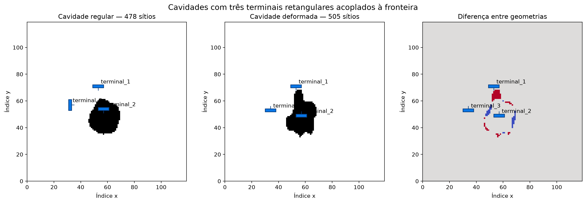

# Results

Este documento reúne ilustrações e interpretações dos resultados obtidos pelo projeto.

Cada resultado deve indicar a equação correspondente em [Report.md](./Report.md), o script que realizou o cálculo, o arquivo `.npz` produzido e o notebook usado para a plotagem.

## Resultado G1 — Comparação das geometrias

- Equação: [Report.md](./Report.md), equações R3–R9.
- Cálculo: `scripts/build_geometries.py`.
- Dados: `data/geometries.npz`.
- Contornos auxiliares: `data/geometries.svg`.
- Plotagem: `notebooks/plot_comparison.ipynb`.
- Figura: `figures/geometry_comparison.png`.

### Ilustração

### Leitura

A lattice possui tamanho efetivo $120\times120$. A cavidade regular contém 478 sítios e a deformada contém 505 sítios. Os terminais azuis foram projetados sobre sítios internos de fronteira das duas máscaras, mantendo correspondência relativa com os três terminais extraídos de `inomeado.svg`.

A diferença entre máscaras mostra a região ocupada apenas pela cavidade deformada, a região ocupada apenas pela cavidade regular e o interior comum. Esse resultado ainda representa apenas geometria discretizada: não permite inferir transporte, caos clássico ou caos quântico.

## Resultado T1 — Transportes entre os três terminais

- Equação: [Report.md](./Report.md), equações R12–R15.
- Cálculo: `scripts/calculate_transport.py`.
- Dados: `data/regular.npz` e `data/deformed.npz`.
- Plotagem: ainda não realizada para os resultados de transporte.
- Lattice: $120\times120$.
- Hopping: convenção interna $t=-1$.
- Energia de Fermi: intervalo $[-1.8,1.8]$, com 37 pontos igualmente espaçados.
- Largura dos leads: 7 sítios.

### Dados disponíveis

Os arquivos contêm:

- `energies`: vetor de 37 energias;
- `transmissions`: matriz tridimensional com forma $(37,3,3)$;
- `mode_counts`: quantidade de modos propagantes por lead e energia;
- `lead_width`: largura efetiva dos três contatos;
- `geometry`: nome da geometria correspondente.

O índice $(d,s)$ da matriz representa a transmissão do terminal de origem $s$ para o terminal de destino $d$. Os pares utilizados no projeto são:

- $T_{12}$, origem 1 e destino 2;
- $T_{13}$, origem 1 e destino 3;
- $T_{23}$, origem 2 e destino 3.

### Faixa de modos propagantes

Os resultados incluem número de modos variando com a energia em cada lead. Os dados ainda não foram usados para excluir energias com conjuntos incompatíveis de canais propagantes.

### Resumo numérico inicial

| Geometria | $T_{12}$ mínimo | $T_{12}$ máximo | $T_{13}$ mínimo | $T_{13}$ máximo | $T_{23}$ mínimo | $T_{23}$ máximo |
|---|---:|---:|---:|---:|---:|---:|
| Regular | 0.000000 | 2.050150 | 0.000000 | 1.847616 | 0.000000 | 1.716919 |
| Deformada | 0.000000 | 2.051337 | 0.000000 | 1.844838 | 0.000000 | 1.737892 |

Esses números são transmissões adimensionais da matriz de espalhamento. Seus máximos não mostram isoladamente uma tendência de comparação, pois a variação de energia e o número de modos podem afetar o resultado.

### Leitura provisória

A comparação direta apresenta pequenas diferenças nos máximos dos pares analisados. Não é adequado concluir sobre caos clássico ou sensibilidade geométrica com base apenas nesses extremos. Uma interpretação quantitativa exige comparar as curvas completas, verificar conservação dos fluxos, usar intervalos compatíveis de modos propagantes e repetir a varredura com discretizações refinadas.

## Resultado V1 — Validação disponível

- Ambiente validado: Conda `Tconda`, Kwant 1.5.0.
- Arquivos existentes: `data/geometries.npz`, `data/regular.npz`, `data/deformed.npz`.
- Figura existente: `figures/geometry_comparison.png`.

### Limites atuais

Os terminais foram implementados como leads semi-infinitos no script de transporte, mas sua correspondência visual com `inomeado.svg` ainda precisa ser revisada. Algumas posições foram projetadas pela distância euclidiana sobre a máscara da lattice e não são uma reprodução direta dos retângulos azuis de origem.

Os dados disponíveis ainda não incluem mapas de densidade local, mapas de corrente, espectro fechado, separações de níveis, matriz de Smith, suscetibilidade espacial ou indicadores clássicos de caos.

Portanto, os dados permitem iniciar a comparação geométrica e o transporte coerente, mas não sustentam ainda uma conclusão sobre caos quântico.
